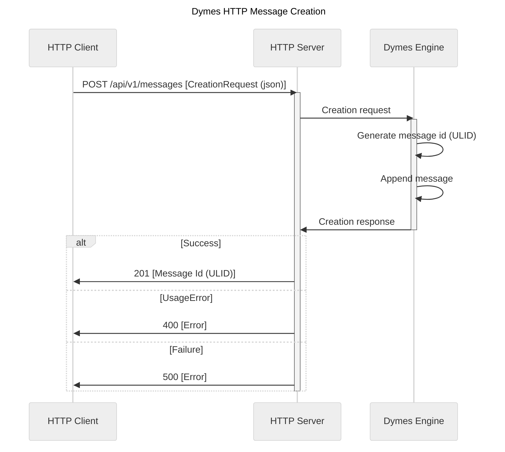
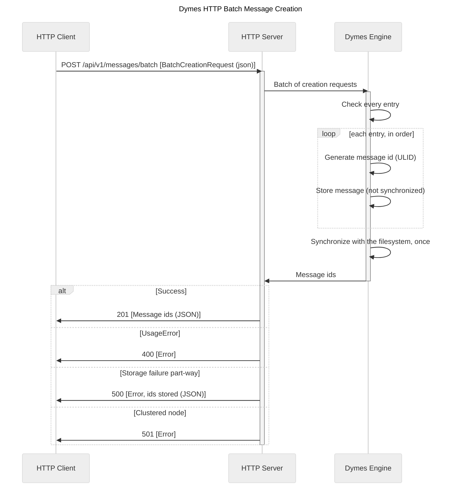
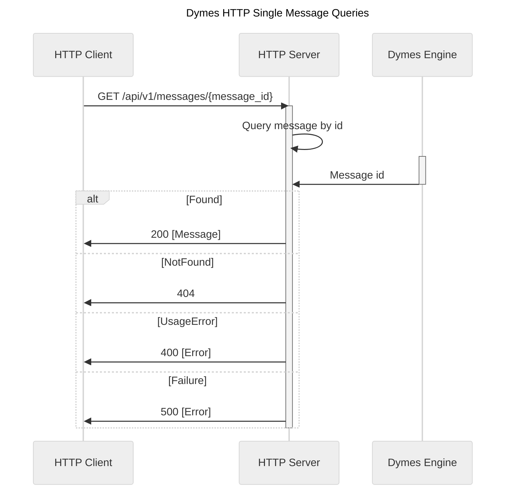
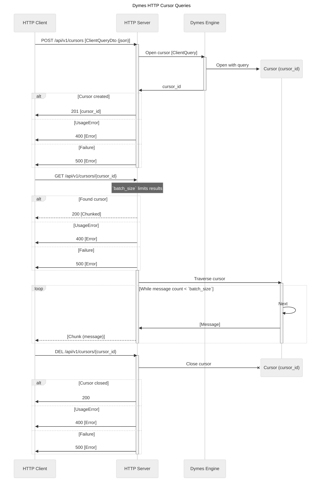

<!--
SPDX-FileCopyrightText: Copyright © 2025 The Dymes project authors

SPDX-License-Identifier: Apache-2.0
-->

# Dymes HTTP Interaction

This document describes the main HTTP interactions between a Dymes client and server node.

<!-- TOC -->
* [Dymes HTTP Interaction](#dymes-http-interaction)
* [Message creation](#message-creation)
  * [Append message](#append-message)
  * [Append messages in a batch](#append-messages-in-a-batch)
* [Message retrieval](#message-retrieval)
  * [Query message](#query-message)
  * [Cursor queries](#cursor-queries)
<!-- TOC -->

# Message creation

## Append message

Stores a message permanently, while ensuring a global ordering of messages.



## Append messages in a batch

Stores many messages in one request, in order, under one hold of the engine and with one synchronization with the
filesystem at the end. The answer comes after the synchronization: `201` means every message in it is durable, as for
a single append. The design is in [dymes-batch-append-proposal.md](dymes-batch-append-proposal.md).

`POST /api/v1/messages/batch`, `application/json`:

```json
{
  "messages": [
    { "channel": 5, "routing": 1, "encoded_msg_body": "bWFya2Vy" },
    { "channel": 5, "routing": 2, "kv_entries": [{ "key": "k", "value": "v" }],
      "encoded_msg_body": "cmVjb3Jk", "correlation_index": 0 }
  ]
}
```

- Each entry is a creation request (`encoded_correlation_id`, `channel`, `routing`, `kv_entries`, `encoded_msg_body`).
  `encoded_correlation_id` and `kv_entries` may be left out.
- **`correlation_index`**: correlates to an earlier entry of the same batch, whose id is assigned in the batch. An entry
  gives at most one of `correlation_index` and `encoded_correlation_id`.
- **Limits:** 1 to 1,000 messages; a request body of at most 8 MiB (which also bounds a single message's request).
  A message whose frame exceeds 2 MiB is refused with `400`, on this endpoint (before anything is stored) and on
  `POST /api/v1/messages`.

Answers:

| Status | Body | When |
| --- | --- | --- |
| `201` | `{"ids": ["01M…", …]}` | Stored and synchronized. One id per entry, in request order, consecutive in the global order |
| `400` | the error name | Invalid JSON, out of limits, a `correlation_index` not pointing at an earlier entry, an `encoded_correlation_id` not stored, or both given. Nothing is stored |
| `500` | `{"error": "…", "ids": ["01M…", …]}` | Storage failed part-way. The listed messages, stored before the failure, stay (the store is append-only), so a client can repair. If the final synchronization fails, no ids are listed: the messages may not be on disk, and the node needs repair |
| `501` | the error name | A clustered node: VSR has no batch operation yet |



# Message retrieval

## Query message

Allows retrieval of a single message from Dymes.



## Cursor queries

Allows retrieveal of a range of messages from Dymes.


